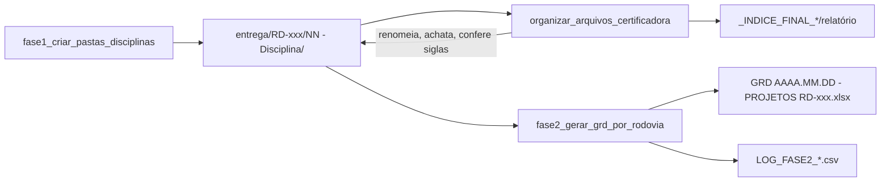

# Remessa GRD por Rodovia

> **Summary in English.** Three Python scripts that prepare a formal document hand-over to a certification body in a
> road-infrastructure program: (1) create the per-road, per-discipline folder structure, (2) organize and rename
> the delivered files (date prefix, flattening, expected document types per discipline) and (3) generate the
> **GRD** (*Guia de Remessa de Documentos*, a transmittal sheet) as a formatted Excel file per road, with logo,
> header and a CSV log. Built by Emmily Maciel; this public copy is sanitized (fictitious road codes RD-xxx).

## Problema

Cada remessa de projetos à certificadora exigia, para cada rodovia: pastas por disciplina (tráfego, topografia,
geologia, hidrologia, ambiental…), arquivos renomeados no padrão de data, conferência dos tipos esperados
(relatório técnico, croqui, desenho) e uma GRD em planilha listando tudo. Feito à mão para 4 rodovias, era lento
e sujeito a esquecer arquivo ou numerar errado.

## Solução

| Script | Faz |
|---|---|
| `fase1_criar_pastas_disciplinas.py` | Cria `RD-xxx/<NN - Disciplina AAAA.MM.DD>/` para cada rodovia × disciplina (`DADOS`) e grava um relatório `.txt` |
| `organizar_arquivos_certificadora.py` | Normaliza nomes, achata subpastas (opcional), confere siglas esperadas (`RT`, `CR`, `DC`) por disciplina e gera índice + relatório final; numeração da próxima GRD por rodovia |
| `fase2_gerar_grd_por_rodovia.py` | Varre as pastas e gera a GRD `.xlsx` de cada rodovia (openpyxl: cabeçalho, logo opcional, bordas, larguras) + log CSV |

Os três têm `DRY_RUN` no topo para simular antes de mexer em arquivo.

## Arquitetura



## Números

| Indicador | Valor | Fonte |
|---|---|---|
| Código | ~1,56 mil linhas em 3 scripts | código |
| Rodovias × disciplinas na configuração | 4 rodovias, 22 pastas de disciplina | execução com dados fictícios |
| Remessas feitas / tempo economizado | `[a confirmar pela autora]` | — |

## Como rodar (pasta fictícia)

```bat
py -m pip install -r requirements.txt
py fase1_criar_pastas_disciplinas.py
py fase2_gerar_grd_por_rodovia.py
```

Por padrão tudo acontece em `.\entrega\` (ignorada pelo Git); outra pasta: `set REMESSA_BASE_DIR=...`.
Atenção: `DRY_RUN = False` por padrão e `organizar_arquivos_certificadora.py` **move** arquivos — teste em cópia.
A logo é opcional (`logo-parceiro.png` ao lado do script).

## O que eu decidi × o que a IA gerou

| Eu (Emmily) decidi | Gerado com apoio de IA, sob minha revisão |
|---|---|
| Dividir em fases (estrutura → organização → GRD) com `DRY_RUN` em cada uma | Formatação da planilha (openpyxl) e inserção de logo |
| Quais disciplinas e tipos de documento cada rodovia deve ter | Normalização de nomes, caminhos longos do Windows, logs |
| Formato da GRD e do nome dos arquivos (prefixo de data) | `[a confirmar pela autora]` — divisão fina |

## Stack

Python 3 · openpyxl · Pillow (cairosvg opcional para logo SVG)

## Aviso

*Dados fictícios. Versão sanitizada de um sistema em uso real; identificadores do cliente foram substituídos.*
Rodovias aparecem como RD-101…RD-104; a numeração de GRD é fictícia; a logo do parceiro foi removida.

Autora: **Emmily Maciel** — [github.com/Emmilymaciell](https://github.com/Emmilymaciell)
